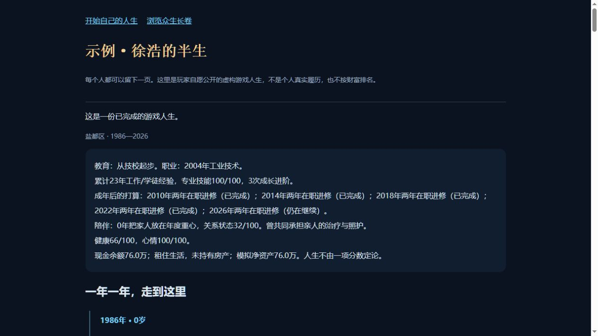

# 发布记录 · 2026-11-20

- 游戏： https://youyoustar.cn/yancheng80s/
- 公共长卷： https://youyoustar.cn/yancheng80s/gallery.html
- 源码仓库： https://github.com/sinoatlas/yancheng80s

页面、两份前端脚本、样式和公共长卷HTML已通过HTTPS读取，内容散列与本地发布包一致；列表接口返回200。Nginx配置检查通过并已重载，应用任务处于Running状态。服务仅监听回环端口，以Local Service身份运行，并配置启动和异常重启；未为验证而重启整台服务器。

程序版本目录与SQLite数据目录分开。上线前保留站点配置备份；更新或回退应用不应覆盖公开人生数据库。服务器密钥与基础设施认证信息不进入仓库。

本地验证：16项模型/成年计划检查、17项剧情检查、100局盐都1986、200局跨年份和100个不同角色通过。公开接口集成测试覆盖发布、幂等、读取、错误凭证、撤下和路径白名单。浏览器已完整走通一局70次选择并发布到本地服务，检查了手机宽度与独立长卷页面；详细体验判断见REVIEW-100.md。

这是可继续迭代的版本。地方史料、真实手机设备表现、完整婚育关系、更多职业差异和健康极限状态仍未全部解决，不标记为“所有问题都已消除”。

## 线上公开人生验证

发布一份明确标作示例的虚构人生返回201；不带身份凭证读取返回200，完整77条经历一致。服务端程序、数据库与测试脚本路径均返回404。随后在浏览器中确认独立公开页面正确显示总结与逐年时间线。

[盐都1986虚构人生示例](https://youyoustar.cn/yancheng80s/gallery.html?id=016cb06c3e024484a183611276285bba)

线上额外一轮连续点击试玩因浏览器控制超时未完整验证，未计为完整通过；已完成的本地全流程与线上接口/分享页验证分别记录，避免混淆。示例的撤下凭证留在本地私有部署目录，不进入Git。
