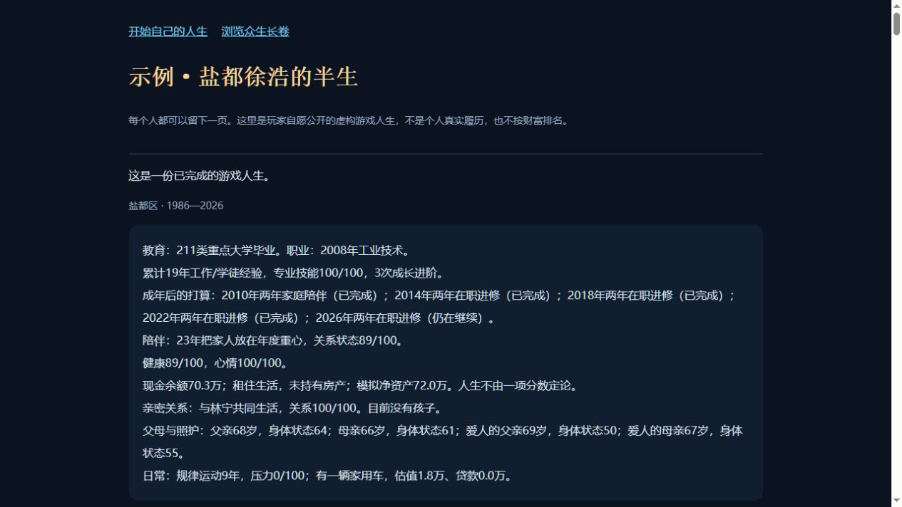

# 发布记录 · 2026-11-20

## v0.3 成年生活、节点回放与叙事深化

发布版本：20261120-181759。在线入口与仓库不变。

- 工作后重心三年一选，每年保留个人选择；三年对照及时呈现，过期回看不会堆到多年以后。
- 伴侣、双方父母、子女、运动、压力、工作与房车持续结算；住院、关系危机和债务有明确触发门槛。
- 大学增加985/211类综合准备与助学路径；非典/疫情按人生阶段和职业带来不同影响。
- 重选回到重要节点，真实推演并保留走马灯；同一节点不改选可以复现完整原账本。
- 结局不显示逐年账本。新增事件用物件、动作与对话写日常，保留早年回忆。

验收：44项机制测试、17项剧情检查、100盐都1986+200跨年份+100角色自动模拟及Python公共接口集成测试通过。两局浏览器抽样，最后一局手机390×844、115次点击，重选动画和双世对照正常、无控制台错误。后续去重修订重新执行了上述自动回归。详见 [新版测评](REVIEW-ADULT-100.md)。

上线时发现服务器仍使用Python 3.8.6，旧版列表在有记录后会触发字典合并兼容问题。切换失败自动回退后定位并修复，重新发布成功；六个公开页面/脚本/样式的HTTPS内容散列与发布包一致，公开列表200。旧示例77条记录完整，新增示例118条记录发布201并经匿名读取核对；两条既有公开记录在最终更新后继续保留。程序、数据库和测试文件路径均不公开。首页与剑来游戏仍返回200。

更新保留程序旧版本及SQLite备份，不修改数据库结构、现有公开记录或Nginx路由。应用任务Running。服务器Python运行环境升级留待单独维护，当前修复只恢复兼容性，未声称升级了运行环境。

[v0.3首次公开人生示例](https://youyoustar.cn/yancheng80s/gallery.html?id=cc30a834147c49dbb7ba44c611ed203a)（完成后不可改写的历史快照）

## v0.2 首次上线记录（历史）

- 游戏： https://youyoustar.cn/yancheng80s/
- 公共长卷： https://youyoustar.cn/yancheng80s/gallery.html
- 源码仓库： https://github.com/sinoatlas/yancheng80s

页面、两份前端脚本、样式和公共长卷HTML已通过HTTPS读取，内容散列与本地发布包一致；列表接口返回200。Nginx配置检查通过并已重载，应用任务处于Running状态。服务仅监听回环端口，以Local Service身份运行，并配置启动和异常重启；未为验证而重启整台服务器。

程序版本目录与SQLite数据目录分开。上线前保留站点配置备份；更新或回退应用不应覆盖公开人生数据库。服务器密钥与基础设施认证信息不进入仓库。

本地验证：16项模型/成年计划检查、17项剧情检查、100局盐都1986、200局跨年份和100个不同角色通过。公开接口集成测试覆盖发布、幂等、读取、错误凭证、撤下和路径白名单。浏览器已完整走通一局70次选择并发布到本地服务，检查了手机宽度与独立长卷页面；详细体验判断见REVIEW-100.md。

这是可继续迭代的版本。地方史料、真实手机设备表现、完整婚育关系、更多职业差异和健康极限状态仍未全部解决，不标记为“所有问题都已消除”。

## 线上公开人生验证

发布一份明确标作示例的虚构人生返回201；不带身份凭证读取返回200，完整77条经历一致。服务端程序、数据库与测试脚本路径均返回404。随后在浏览器中确认独立公开页面正确显示总结与逐年时间线。

[盐都1986虚构人生示例](https://youyoustar.cn/yancheng80s/gallery.html?id=016cb06c3e024484a183611276285bba)

线上额外一轮连续点击试玩因浏览器控制超时未完整验证，未计为完整通过；已完成的本地全流程与线上接口/分享页验证分别记录，避免混淆。示例的撤下凭证留在本地私有部署目录，不进入Git。
